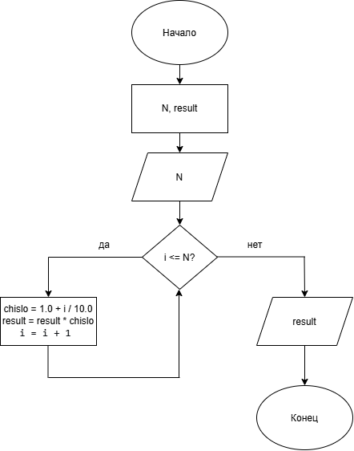

# Домашнее задание к работе 2
## Условие задачи
Вычислите для целого N, заданного пользователем, значение произведения:
1,1 · 1,2 · 1,3 · … · 1,N
## 1. Алгоритм и блок-схема
### Алгоритм решения
1. Начало
2. Объявить переменные:
   - целое число N
   - result = 1.0
   - chislo
3. Ввести значение переменной:
   - ввод значения N
4. Проверить корректность N > 0
5. Запустить цикл i от 1 до N:
   - chislo = 1.0 + i / 10.0
   - result = result * chislo
6. Вывести результаты расчетов с подстановкой всех значений в текст
7. Конец
### Блок-схема

## 2. Реализация программы
```
#define _CRT_SECURE_NO_WARNINGS
#include <stdio.h>
#include <locale.h>

int proizv()
{
    setlocale(LC_CTYPE, "RUS");

    int N, i;
    double result = 1.0;
    double chislo;

    printf("=============================================================\n");
    printf("ВЫЧИСЛЕНИЕ ПРОИЗВЕДЕНИЯ\n");
    printf("=============================================================\n");
    printf("Условие задачи:\n");
    printf("Вычислить произведение 1.1 * 1.2 * 1.3 * ... * 1.N\n");
    printf("Введите целое N: ");
    scanf("%d", &N);
    printf("=============================================================\n");

    if (N < 0) {
        printf("Ошибка: N должно быть неотрицательным.\n");
        printf("=============================================================\n");
        return 0;
    }

    for (i = 1; i <= N; i++) {
        chislo = 1.0 + (double)i / 10.0;
        result = result * chislo;
    }

    printf("Результат:\n");
    printf("Произведение = %.6f\n", result);
    printf("=============================================================\n");
}

int main()
{
    proizv();
    getchar();
    return 0;
}
```
## 3. Результат работы программы
```
=============================================================
ВЫЧИСЛЕНИЕ ПРОИЗВЕДЕНИЯ
=============================================================
Условие задачи:
Вычислить произведение 1.1 * 1.2 * 1.3 * ... * 1.N
Введите целое N: 7
=============================================================
Результат:
Произведение = 9.801792
=============================================================
```
## 4. Информация о разработчике
**Холодова Елизавета Юрьевна бИЦТ-262**
